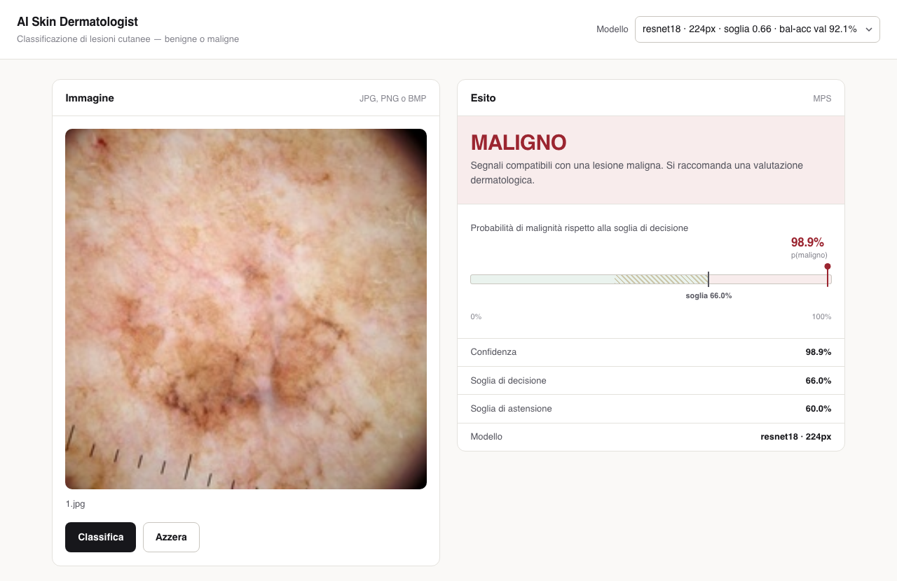

# AI Skin Dermatologist

Classificatore di lesioni cutanee **benigne** o **maligne** a partire da immagini
dermatoscopiche, realizzato come progetto universitario del corso Ai Lab.



## Il progetto

Molte lesioni della pelle si assomigliano a un occhio non esperto, ma distinguere
quelle benigne da quelle maligne, come il melanoma, è fondamentale per la diagnosi
precoce del cancro della pelle. Il progetto prova a farlo automaticamente, a partire
da una fotografia della lesione, confrontando due approcci:

- **`cnn_v1`**, una CNN progettata da zero: cinque blocchi convoluzionali, da 32 a 512
  canali, seguiti da un classificatore denso con dropout.
- **`resnet18`**, una ResNet18 pre-addestrata su ImageNet e sottoposta a fine-tuning
  completo. Invece di imparare a vedere da zero con poco più di 2.000 immagini, parte
  da filtri che riconoscono già bordi, texture e colori, e deve imparare solo quali di
  questi indicano una lesione maligna.

I modelli sono addestrati su un [dataset pubblico di Kaggle](https://www.kaggle.com/datasets/fanconic/skin-cancer-malignant-vs-benign)
di 3.297 immagini, divise in 2.241 per l'addestramento, 396 per la validazione e 660
per il test.

## Risultati

| Modello | Accuratezza | AUROC | Sensibilità | Specificità |
|---|---:|---:|---:|---:|
| `cnn_v1` — CNN progettata da zero | 86,2% | 0,942 | 86,3% | 86,1% |
| `resnet18` — fine-tuning da ImageNet | **90,0%** | **0,967** | 90,3% | 89,7% |

Misurati sulle 660 immagini di test, tenute da parte fino alla valutazione finale. Il
pre-addestramento porta 3,8 punti di accuratezza in più rispetto alla rete progettata
da zero.

Il [report del progetto](AI%20Skin%20Dermatologist%20-%20Report.pdf) descrive
architetture, addestramento e risultati nel dettaglio.

## Come provarlo

Serve Python 3.9 o superiore. I due modelli addestrati non sono nel repository ma
allegati alla [Release v1.0](https://github.com/AlessioCavedal/Ai-Skin-Dermatologist-Classifier/releases/tag/v1.0):
una volta scaricati in `Model/`, il classificatore funziona senza bisogno del dataset.

```bash
git clone https://github.com/AlessioCavedal/Ai-Skin-Dermatologist-Classifier.git
cd Ai-Skin-Dermatologist-Classifier
python3 -m venv .venv
source .venv/bin/activate          # su Windows: .venv\Scripts\activate
pip install -r Code/requirements.txt

curl -L -o Model/cnn_v1.pth   https://github.com/AlessioCavedal/Ai-Skin-Dermatologist-Classifier/releases/download/v1.0/cnn_v1.pth
curl -L -o Model/resnet18.pth https://github.com/AlessioCavedal/Ai-Skin-Dermatologist-Classifier/releases/download/v1.0/resnet18.pth

cd Code
python webapp.py                   # interfaccia web su http://127.0.0.1:7860
python predict.py immagine.jpg     # oppure da riga di comando
```

Nell'interfaccia si carica un'immagine, anche trascinandola nella pagina, e si sceglie
quale modello usare. Il risultato riporta la classe, la confidenza e la probabilità di
malignità rispetto alla soglia di decisione tarata sul validation set; quando la
confidenza scende sotto il 60% il modello si astiene e dichiara l'esito incerto.

Su macOS, a installazione fatta, basta un doppio clic su `Avvia interfaccia.command`,
che avvia il server e apre il browser. Se il sistema lo blocca perché scaricato da
internet: *Impostazioni di Sistema → Privacy e sicurezza → Apri comunque*.

## Struttura

```
├── Code/          pipeline: dataset, modelli, addestramento, valutazione e interfaccia
├── Model/         i modelli addestrati, da scaricare dalla Release
├── Results/       curve di addestramento, matrici di confusione e curve ROC
└── Skin cancer/   il dataset Kaggle, non incluso: serve solo per riaddestrare
```

Dettagli implementativi e comandi per l'addestramento: [`Code/README.md`](Code/README.md).

## Avvertenza

Strumento realizzato a scopo didattico: **non è un dispositivo medico e non va usato
per decisioni cliniche.** Non sostituisce il parere di un dermatologo, e un esito
benigno non esclude la necessità di un controllo specialistico.

## Licenza

Il codice è rilasciato sotto licenza [MIT](LICENSE): puoi usarlo, modificarlo e
ridistribuirlo liberamente, purché citi l'autore mantenendo il file `LICENSE`. Il
dataset appartiene ai rispettivi autori e non è coperto da questa licenza.
